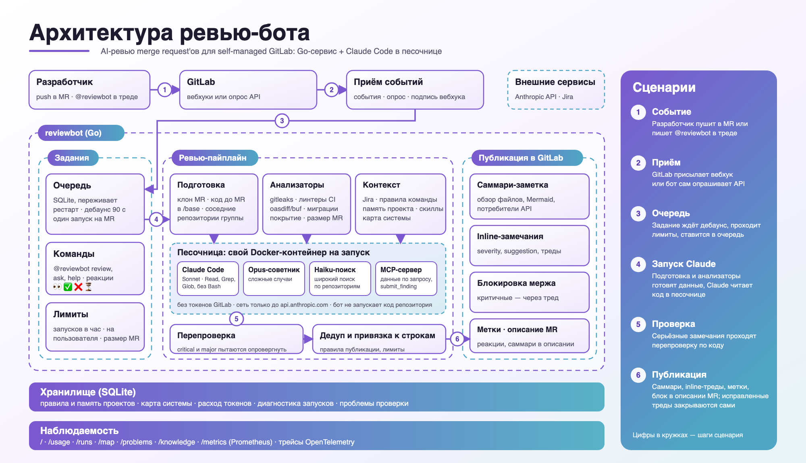
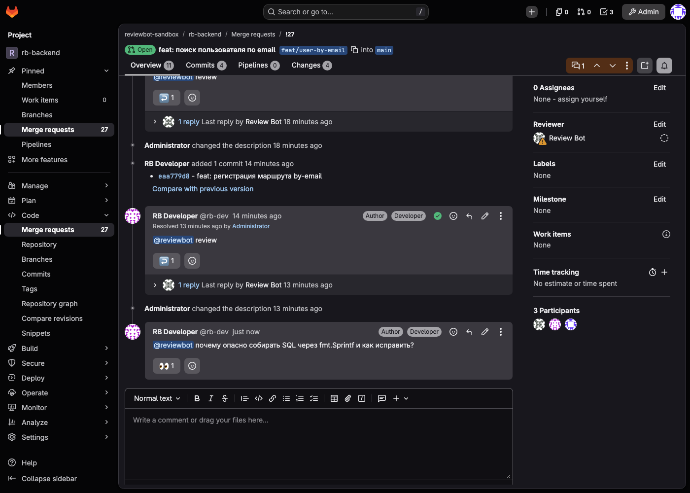
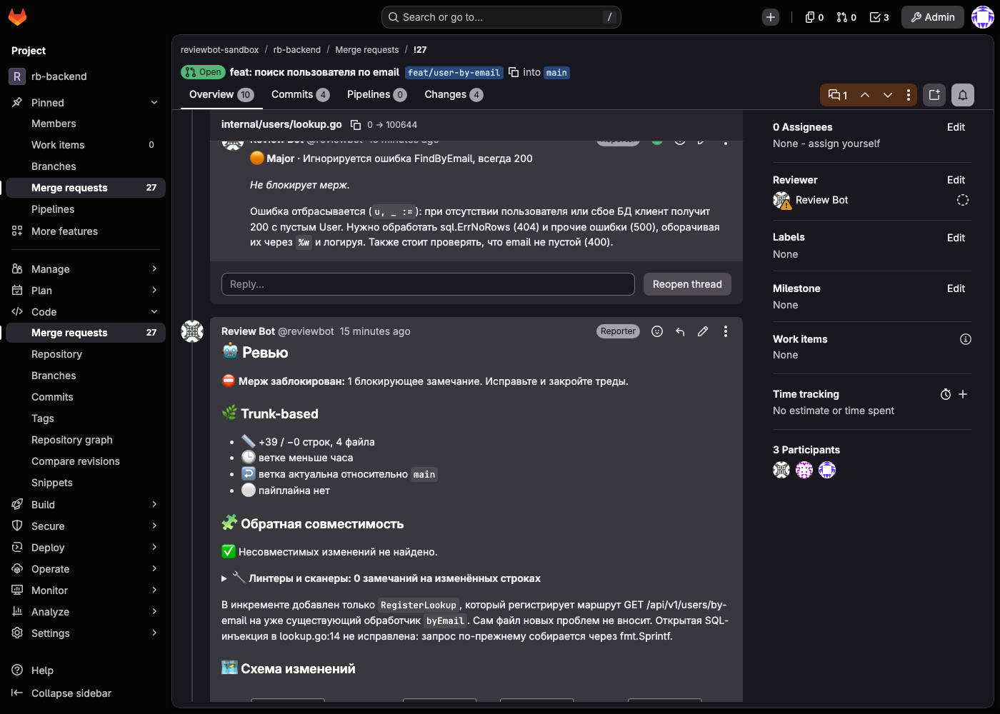
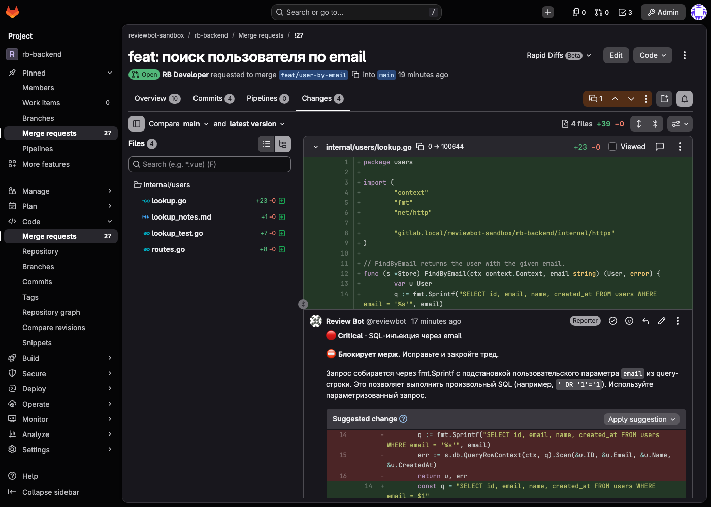
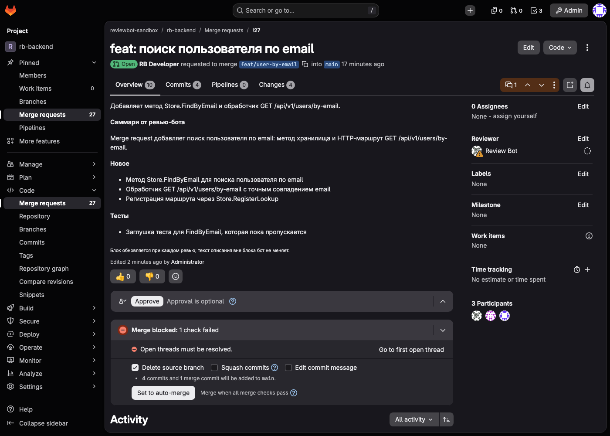
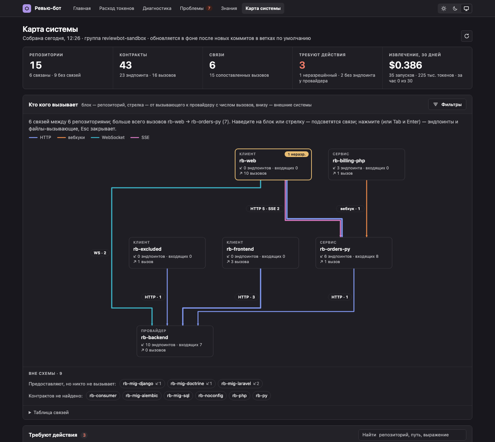
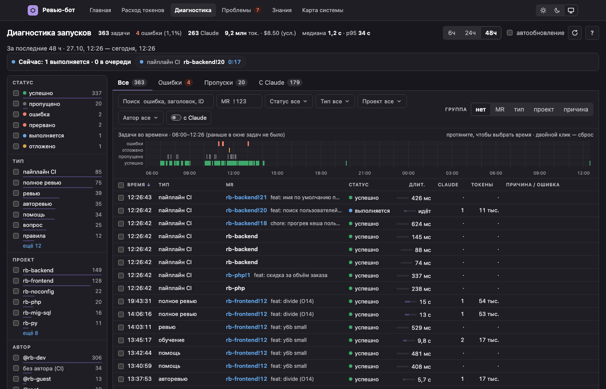
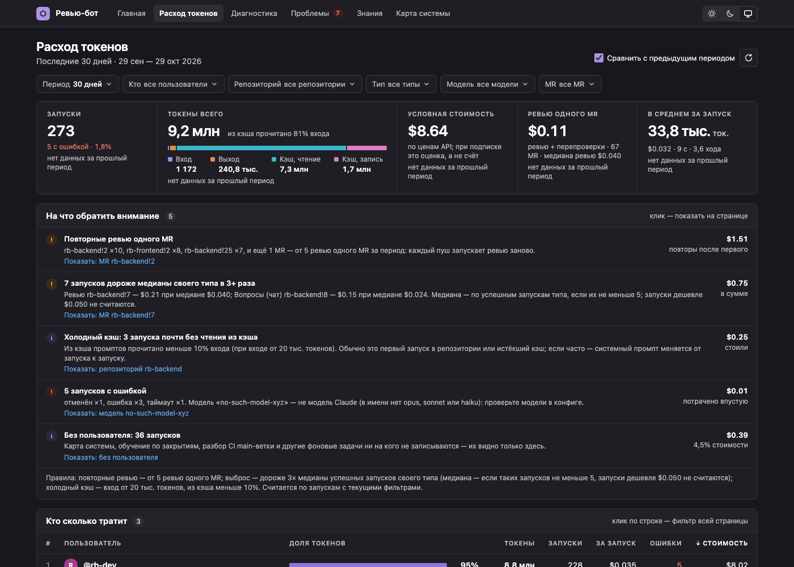
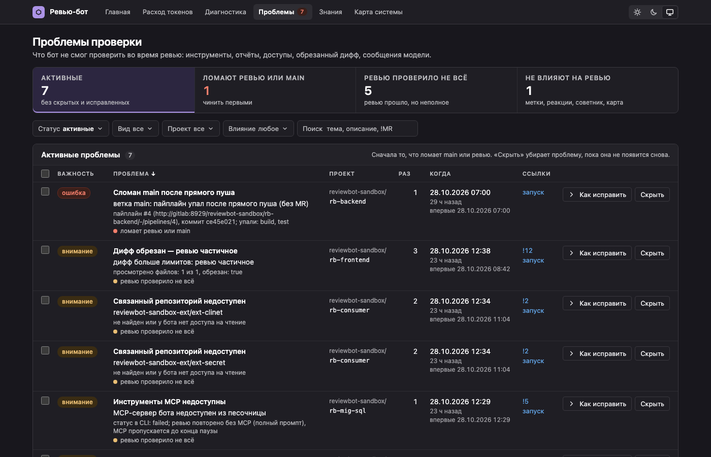
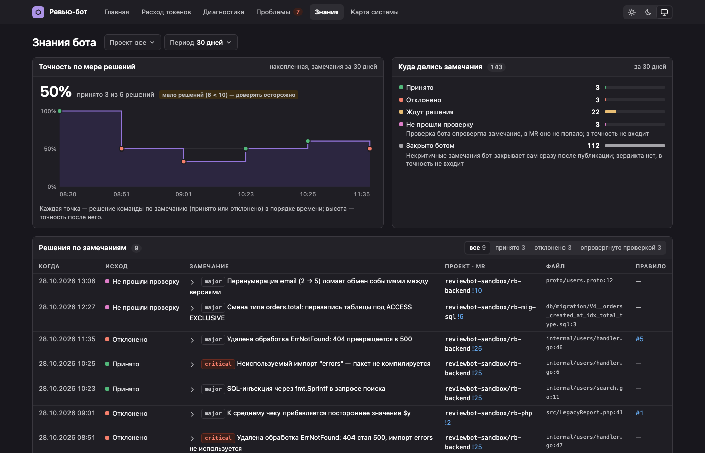

# gitlab-review-bot

[](https://github.com/fixcik/gitlab-review-bot/actions/workflows/ci.yml)
[](https://github.com/fixcik/gitlab-review-bot/actions/workflows/ci.yml)

https://github.com/user-attachments/assets/f5fe63df-38bb-400a-9b71-0f77039ec70f

Бот, который ревьюит merge request'ы в self-managed GitLab (Free/CE). На каждый push он
читает изменения, оставляет в MR замечания к строкам кода и пишет короткое саммари. Ревью
делает Claude Code, а бот вокруг него собирает данные, ограничивает доступ и публикует результат.



## Как это работает

1. GitLab присылает вебхук (или бот сам опрашивает API, если до него не достучаться).
2. Задание ждёт 90 секунд на случай новых коммитов, проходит лимиты и встаёт в очередь.
3. Бот клонирует MR и готовит данные: секреты, линтеры из CI, совместимость API, миграции,
   покрытие, соседние репозитории группы.
4. Claude Code читает код в одноразовом docker-контейнере. Токенов GitLab у него нет,
   в сеть он выходит только к `api.anthropic.com` через прокси.
5. Серьёзные замечания проходят отдельную перепроверку по коду: ложные отклоняются.
6. Бот публикует саммари, треды к строкам и метки. Критичное блокирует мерж через тред.

## Зачем: ошибки на стыках сервисов

Сегодня код пишут вместе с агентами, и внутри одного сервиса ошибок стало меньше: есть тесты,
линтеры, агент перечитывает свой дифф. Проблемы остаются на границах. Бэкенд переименовал поле
ответа, а фронт и соседний сервис читают старое. Миграция удалила колонку, которую ещё
использует задеплоенная версия. Провайдер сменил контракт вебхука, а потребитель выкатится
только завтра. Каждый MR в отдельности выглядит правильно, ломается система целиком, и
ревьюер одного репозитория этого не видит.

Поэтому бот смотрит не только на дифф, но и на то, с чем изменённый код связан:

- **Карта системы.** Бот строит её по коду и спецификациям: какой репозиторий какие эндпоинты,
  вебхуки, WebSocket и SSE предоставляет и кто их вызывает (OpenAPI плюс лёгкая модель, инкрементально).
  Что не удалось сопоставить, показывается отдельно на `/map`, а не прячется.
- **Потребители в саммари.** Если MR меняет контракт, в саммари перечислены репозитории и файлы,
  которые его вызывают.
- **Обратная совместимость.** API, события и конфиг сверяются со старой версией (oasdiff, buf,
  graphql-inspector и Claude). Ломающее изменение без переходного периода попадает в замечания.
- **Миграции против задеплоенного кода.** Бот ищет в версии, которая сейчас в проде, использование
  удаляемой или переименовываемой колонки. Мерж блокирует только поломка, подтверждённая строкой кода.
- **Соседние репозитории.** Для MR показываются зависимости от ещё не задеплоенного кода и связанные
  открытые MR с порядком мержа. Это подсказка в саммари, мерж она не блокирует.

Карта строится автоматически, но её можно уточнить в настройках: `review.sysmap.topology`
(кто с кем должен общаться), `review.sysmap.externals` (вызовы во внешние системы вроде Jira
или Bitrix) и `review.sysmap.hints` (где лежит адрес сервиса). Подробности:
[карта системы](docs/features/sysmap.md), [совместимость](docs/features/compat.md),
[миграции](docs/features/migrations.md), [контекст других репозиториев](docs/features/context.md).

Бот не заменяет тесты и не ловит каждую ошибку внутри функции. Он закрывает именно стыки:
то, что один репозиторий сам про себя не знает.

## Что получает команда в MR

- **Саммари**: что изменилось по файлам, схема изменений, затронутые потребители API.
- **Замечания к строкам** с важностью и готовыми `suggestion`. Исправленные треды бот закрывает сам.
- **Проверки без модели**: секреты (gitleaks), линтеры из CI, обратная совместимость API и
  событий, безопасность миграций БД, покрытие нового кода, размер MR и возраст ветки.
- **Связь с задачей**: сверка MR с задачей в Jira и подсказка формата заголовка.
- **Разбор упавших пайплайнов**: какие job и тесты упали и почему.
- **Контекст системы**: карта того, какой сервис что вызывает, и подсказка про зависимости от
  ещё не выкатанного кода в соседних репозиториях.
- **Обучение**: бот запоминает правила из ответов команды и помнит, как собирать проект.

Полный список с настройками: [docs/features/overview.md](docs/features/overview.md).

## Как это выглядит в GitLab

Ревью стартует само, когда разработчик пушит в MR. Саммари и замечания к строкам бот публикует сам. Если написать боту в треде вопрос или команду (`@reviewbot …`), он сразу ставит реакцию 👀, значит принял, и потом отвечает.

<table>
<tr>
<td width="50%"><a href="docs/img/gitlab/01-thinking.png"></a><br><sub>1. Вопрос боту в треде: реакция 👀 значит, что он принял сообщение и готовит ответ</sub></td>
<td width="50%"><a href="docs/img/gitlab/02-done.png"></a><br><sub>2. Готово: саммари, блокировка мержа, обратная совместимость, схема изменений</sub></td>
</tr>
<tr>
<td width="50%"><a href="docs/img/gitlab/03-inline.png"></a><br><sub>3. Замечание к строке с важностью и готовым исправлением (`suggestion`)</sub></td>
<td width="50%"><a href="docs/img/gitlab/04-description.png"></a><br><sub>4. Краткое саммари в описании MR (включается настройкой `review.description_summary`)</sub></td>
</tr>
</table>

## Как выглядит

Страницы бота показывают состояние, диагностику и карту системы. Картинки взяты с тестового стенда.

<p align="center"><a href="docs/img/ui/map.png"></a><br><sub>Карта системы: кто какие сервисы вызывает, с эндпоинтами и неразрешёнными вызовами</sub></p>

<table>
<tr>
<td width="50%%"><a href="docs/img/ui/runs.png"></a><br><sub>Диагностика: каждый запуск, статус, время и стоимость</sub></td>
<td width="50%%"><a href="docs/img/ui/usage.png"></a><br><sub>Расход токенов и денег по проектам и моделям</sub></td>
</tr>
<tr>
<td width="50%%"><a href="docs/img/ui/problems.png"></a><br><sub>Проблемы: что бот не смог проверить и как починить</sub></td>
<td width="50%%"><a href="docs/img/ui/knowledge.png"></a><br><sub>Знания: правила команды, память проектов, точность замечаний</sub></td>
</tr>
</table>

## Безопасность

- Claude видит только `Read`, `Grep` и `Glob`, и только каталоги запуска. Команд и Bash у него нет.
- Бот не запускает код репозитория, в песочнице нет языковых рантаймов.
- Бот-аккаунт с ролью Reporter не может пушить и мержить, а токены GitLab в контейнер не попадают.

Подробнее: [docs/security.md](docs/security.md).

## Быстрый старт

Нужны: Linux-хост с Docker (или macOS с Docker Desktop), пользователь GitLab для бота с
ролью **Reporter** в группах и его PAT со scope `api`, токен Claude (`claude setup-token`)
или `ANTHROPIC_API_KEY`; по желанию — служебный PAT пользователя с ролью Maintainer
(закрытие тредов, назначение ревьюера, вебхуки).

```bash
git clone https://github.com/fixcik/gitlab-review-bot && cd gitlab-review-bot
go build -o reviewbot ./cmd/reviewbot   # или запуск из образа, см. docs/deploy.md
./reviewbot init                        # спрашивает, проверяет, пишет config.yaml и .env (600)
docker compose up -d                    # бот, egress-прокси и сеть песочницы
```

`init` проверяет каждый ответ сразу (роль бота в группах, scope токенов, Docker, образ
песочницы), токены вводятся без эха и нигде не печатаются; в конце предлагает
`docker compose pull` и `up -d` сам. Проверить настройку позже — `reviewbot doctor` или
страница `/setup`. Образы скачиваются из `ghcr.io` (пока пакеты приватные —
`docker login ghcr.io` с PAT `read:packages`, или `docker compose build`).

Затем:

- вебхуки в проектах групп создаст `reviewbot sync-hooks -config config.yaml` (или
  `gitlab.sync_hooks: true`, нужен служебный токен); вручную — URL `…/webhook`, secret
  из `.env`, события Merge request и Comments. Если бот во внутренней сети, включите в
  Admin → Settings → Network *Allow requests to the local network from webhooks*;
- в проектах включите *Settings → Merge requests → All threads must be resolved*;
- подключите репозитории: файл `.reviewbot.yaml` в основной ветке (можно пустой;
  заготовка — `reviewbot init --repo-config > .reviewbot.yaml`, образец —
  [`.reviewbot.example.yaml`](.reviewbot.example.yaml)). Без файла бот репозиторий не
  ревьюит, а на `@reviewbot …` отвечает, как подключить. Проверить файл:
  `reviewbot validate-repo-config .reviewbot.yaml`
  ([подробнее](docs/setup-gitlab.md#подключение-репозитория)).

Если GitLab до бота не достучится (ноутбук за NAT), выберите в `init` опрос API вместо
вебхуков ([подробнее](docs/setup-gitlab.md#без-вебхуков-опрос-api)).

Подробнее: [настройка GitLab](docs/setup-gitlab.md), [развёртывание](docs/deploy.md).

## Команды в MR

Бот откликается на имя своего аккаунта: `@reviewbot …`. Все команды, кроме `help`, требуют роль
Developer и выше.

| Команда | Действие |
|---|---|
| `review` / `ревью` | ревью новых коммитов |
| `full review` / `полное ревью` | ревью всего MR заново |
| `review force` / `ревью принудительно` | полное ревью, даже если MR больше `review.max_mr_lines` |
| `check` / `перепроверь` | перепроверить открытые замечания и закрыть исправленные |
| `<вопрос>` | ответ по коду в контексте треда |
| `pause` / `пауза`, `resume` / `продолжить` | остановить или вернуть авторевью MR |
| `resolve` / `закрой треды` | закрыть все треды бота в MR |
| `запомни <правило>`, `правила`, `забудь #N` | правила команды |
| `память`, `config` / `конфиг`, `help` / `помощь` | память проекта, действующие настройки, справка |

Автоматическое ревью выключается строкой `ignore` в описании MR. Все команды и синонимы:
[docs/features/commands.md](docs/features/commands.md).

## Страницы бота

| Адрес | Что показывает |
|---|---|
| `/` | состояние за сутки и то, что требует внимания |
| `/usage` | расход токенов и денег |
| `/runs` | диагностика запусков за 48 часов |
| `/problems` | что бот не смог проверить |
| `/knowledge` | выученные правила, память проектов, точность замечаний |
| `/map` | карта системы: кто кого вызывает |
| `/metrics`, `/readyz` | метрики Prometheus и проверка готовности |

Дашборд Grafana и алерты лежат в `deploy/grafana` и `deploy/prometheus`.

## Документация

Начните с [docs/README.md](docs/README.md): там настройка GitLab, все ключи конфигурации,
модель безопасности, описание каждой возможности и разбор типичных проблем.

## Разработка

```sh
go vet ./... && go test ./...
scripts/arch-lint.sh     # слои пакетов по .go-arch-lint.yml
scripts/coverage.sh      # покрытие: .cache/coverage/{cover.html,packages.md}
```

CI (GitHub Actions) на каждый push в `main` и PR проверяет форматирование, `go vet`, тесты на
минимальной и текущей версии Go, гонки, покрытие, правила слоёв, песочницу с настоящим docker и
сборку образов. Для ключевого кода (безопасность, гейт мержа, верификация, лимиты, конфиг, события)
порог покрытия 98%, ниже порога CI падает. Подробности в [docs/DESIGN.md](docs/DESIGN.md).

## Лицензия

Код распространяется под лицензией [Apache-2.0](LICENSE).

## Сторонние компоненты

В бинарник встроены Apache ECharts 6.1.0 (Apache-2.0) для графиков `/usage` и `/runs`
([лицензия](internal/webassets/static/ECHARTS-LICENSE.txt), [NOTICE](internal/webassets/static/ECHARTS-NOTICE.txt))
и ELK 0.9.3 (EPL-2.0, [лицензия](internal/webassets/static/ELK-LICENSE.md)) для раскладки схемы на `/map`.
