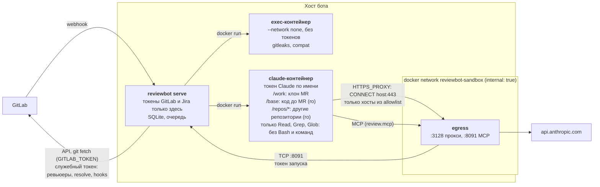

# Безопасность

Ревью делает `claude -p`, который **только читает** код: у модели есть `Read`,
`Grep` и `Glob` (плюс сабагент `code-search` с теми же тремя инструментами и, если
включено, MCP-инструменты бота). Команд модель не запускает вовсе: ни Bash, ни git,
ни команд репозитория, ни подготовки окружения. Код MR чужой и потенциально
враждебный (prompt injection, вредные `Makefile`, `go generate`, npm-скрипты), но
ничто из него не исполняется. Поэтому:

- у бот-аккаунта минимальные права в GitLab, а клиент GitLab в боте отклоняет всё,
  кроме заметок и реакций (award emoji);
- Claude работает в одноразовом контейнере без прямого выхода в сеть и без токенов
  GitLab; видит он только смонтированные каталоги: клон MR (`/work`), код до MR
  (`/base`), другие репозитории (`/repos`), скиллы (`/skills`), и читать может
  только их (правила разрешений, [область чтения](#область-чтения-internalclaudereadscopego));
- Claude только возвращает JSON (и, с MCP, вызывает инструменты бота, которые
  только читают результаты анализаторов), а публикует результат сервис.

Модель угроз поэтому простая: инъекция в коде или описании MR может повлиять только
на **текст** ревью (пропустить или выдумать замечание), но не на то, что
исполняется, куда уходят данные и что пишется в GitLab. Исполняются только
детерминированные проверки самого бота (exec-контейнер без сети и токенов).

## Модель изоляции



### Сеть

- Контейнер с Claude подключён только к internal-сети `reviewbot-sandbox` без
  маршрута наружу. Единственный путь — прокси `egress`: он принимает только
  `CONNECT host:443` и только для хостов из `sandbox.egress_allow` (точное имя или
  `*.example.com` для поддоменов). IP-адреса, другие порты и обычный HTTP
  отклоняются (403/405). TLS прокси не расшифровывает, каждое решение пишет в лог.
- GitLab, внутренние сервисы и метаданные облака из контейнера недоступны.
- Других процессов, кроме самого Claude Code, в контейнере нет: модель не
  запускает команд, так что «подпроцессу, который ходит в сеть» взяться неоткуда.
- MCP-инструменты бота (`review.mcp`, включено по умолчанию): egress пробрасывает
  один порт (`:8091`) на один фиксированный адрес — MCP-слушатель бота. Сам бот к сети
  песочницы не подключён, его публичный HTTP-порт оттуда не виден. Подробнее —
  [ниже](#mcp-сервер-бота-граница-песочница--бот).
- Трейсинг (`tracing.*`) ходит в приёмник из процесса бота, не из песочницы. Только
  экспериментальный `tracing.claude_cli: true` выпускает песочницу к приёмнику: https на
  443 — через egress (хост добавляется в разрешённые только с этим флагом), http —
  напрямую, приёмник должен быть в сети песочницы ([ниже](#трейсинг)).
- Сетевых контейнеров без egress больше нет (setup-команды удалены).
- gitleaks и проверки совместимости — `--network none`.
- **Линтеры бот не запускает.** Раньше phpstan, phpcs, eslint, golangci-lint, ruff,
  semgrep и команды `lint.custom` исполнялись в песочнице на коде MR — а с ними и
  код репозитория (конфиги ESLint и PHPStan с расширениями, автозагрузчик Composer,
  `vendor/bin/*`, `node_modules/.bin/*`). Теперь результаты линтеров берутся из
  отчётов CI репозитория (`lint.ci`): бот только скачивает артефакт job через API
  (с размером не больше 20 МБ, без пересылки токена в объектное хранилище) и
  разбирает JSON/XML. На недоверенном коде бот исполняет меньше инструментов:
  gitleaks (только `.git`, конфиг из целевой ветки) и проверки совместимости.
  Отчёт CI — данные репозитория: текст сообщений экранируется и уходит Claude
  внутри `<untrusted_tool_results>`; ветку MR, в которой подменили job линтера,
  бот не отличит от настоящей — такой отчёт может «потерять» замечания, но не
  исполнить что-либо у бота.
- oasdiff по умолчанию скачивает внешние `$ref` (SSRF на спецификациях из MR). Бот
  передаёт `--allow-external-refs=false`, если в спецификации нет ссылок на другие
  файлы; если есть только относительные ссылки на файлы внутри репозитория —
  разрешает их (они лежат рядом, а сети нет); ссылки по URL, абсолютные пути и выход
  за пределы репозитория он отклоняет сам, не запуская oasdiff
  ([compat.md](features/compat.md#внешние-ref)). Конвертер Swagger 2.0 (`oas2to3`)
  внешние ссылки не загружает вовсе.

### Файлы

- Код MR для Claude — рабочее дерево head (`/work`), смонтированное **только для
  чтения** (`:ro`). С кэшем (`review.checkout_cache`, по умолчанию) это общее для
  задач дерево `<data_dir>/repos/trees/<проект>@<sha>`: файлы коммита без `.git`,
  извлечённые из зеркала с временным индексом (ни `.git`-ссылки на зеркало, ни записи
  в зеркале), файлы 0444, каталоги 0555, удаляется через `ttl` после последнего
  использования. Без кэша — одноразовый клон `<data_dir>/repos/work/<random>` с
  настоящим `.git` (объекты захардлинкованы, `alternates` нет, `origin` — заглушка),
  удаляется после запуска. На запись exec-контейнерам проверок монтируются только
  каталоги задачи (`<data_dir>/repos/work/<random>/…`): клон истории для gitleaks
  (настоящий `.git` без рабочего дерева, без `alternates`, `origin` — заглушка) и
  спецификации compat; дерево MR в них не попадает.
- После checkout бот удаляет симлинки, указывающие за пределы клона (абсолютные,
  `../..`, «висячие»), чтобы read-инструмент не прочитал файлы хоста.
- Свои каталоги (`.reviewbot-lint/`, `.reviewbot-compat/`; без кэша — в клоне, с
  `.git/info/exclude`) бот создаёт без перехода по симлинкам: симлинк или файл на
  этом месте (из MR) удаляется, каталог создаётся заново и проверяется, что он
  внутри клона; файлы пишутся через `os.Root`, который не выходит за пределы каталога
  (`internal/safefs`).
- **Код до MR** — `/base`: дерево merge base (с кэшем — общее
  `<data_dir>/repos/trees/<проект>@<sha>-base`, без кэша — `git archive` из клона в
  `<data_dir>/repos/work/<клон>-tree-<random>`; без `.git`, файлы 0444, без
  внешних симлинков, без `.claude/` и `.mcp.json`), монтируется `:ro`, размер
  ограничен `review.context.max_repo_mb` (проверяется до записи), удаляется после
  запуска или, с кэшем, через `ttl` после последнего использования.
  Вместо `git show <merge base>:<path>` модель читает `/base/<path>`. Свои проверки
  бот (доказательство `deployed_usage` у миграций, compat) по-прежнему делает по git
  клона, а не по этому снимку.
- Другие репозитории ([context.md](features/context.md)) монтируются как снимки без
  `.git`, `:ro` (запись невозможна на уровне ядра), файлы 0444, без внешних симлинков,
  без `.claude/` и `.mcp.json`. В exec-контейнеры снимки не монтируются.
- [Карта системы](features/sysmap.md) читает те же снимки на хосте: только обычные
  файлы (симлинки пропускаются), с ограничением размера; код ничем не запускается
  (ни `Runner.Exec`, ни моделью). Файлы уходят лёгкой модели без инструментов, в
  пустом каталоге, внутри `<untrusted_file>`, ответ проверяется по схеме и по
  содержимому пачки (файлы, строки, протоколы).
- Токен бота не пересылается при редиректе на другой хост (артефакты CI часто
  отдаются редиректом на объектное хранилище): клиент GitLab убирает `PRIVATE-TOKEN`
  и `Authorization`, если хост или схема цели отличаются от `gitlab.url`.
- Отчёт о покрытии из артефакта CI разбирается ботом как данные (не больше
  `review.coverage.max_report_mb`); модели достаются только посчитанные
  непокрытые изменённые строки (в промпте или через MCP-инструмент `coverage`), в
  клон ничего не кладётся.
- Сабагент `code-search` (`claude.search_model`) получает только `Read`, `Grep` и
  `Glob`; разрешён только он (`Task(code-search)`), встроенные сабагенты Claude Code
  запрещены явно и не входят в allowlist режима `dontAsk`.
- Скиллы команды ([skills.md](features/skills.md)) берутся только из
  `review.skills.dir` на сервере, копируются для каждого запуска (только обычные
  файлы, 0444) и монтируются `:ro` как `/skills`. `.claude/skills` и
  `.claude/commands` из репозитория не загружаются (`--setting-sources user`,
  `--disable-slash-commands`; проверено на Claude Code 2.1.310).

### Процесс

`--read-only` корневая ФС, tmpfs для `/tmp` и `$HOME`, `--cap-drop ALL`,
`--security-opt no-new-privileges`, `--pids-limit 512`, `--cpus` и `--memory`,
непривилегированный uid (как у сервиса; если сервис запущен от root, в лог пишется
предупреждение). По таймауту или отмене контейнер удаляется (`docker rm -f`).

### Права Claude

- Встроенные инструменты сведены к `Read,Grep,Glob` (`--tools`; с сабагентом
  `code-search` ещё `Task`): Bash, Edit, Write, NotebookEdit, Agent и
  веб-инструменты недоступны в принципе; `Bash`, `WebFetch`, `WebSearch`, `Edit`,
  `Write`, `NotebookEdit` дополнительно в deny.
- Allowlist (`--allowedTools`) фиксирован и ограничен путями (см. ниже):
  `Read(…)` для каталогов запуска, `Task(code-search)` и MCP-инструменты бота по
  именам. Голых `Read`, `Grep`, `Glob` в нём нет: такое правило разрешает
  инструмент для **любого** пути. Настроек, которые allowlist расширяют, нет: ключи
  `tools`, `review.default_tools` и `setup` удалены, конфиг с ними не загружается
  ([configuration.md](configuration.md#удалённые-ключи)).
- `--permission-mode dontAsk --permission-prompts none`: всё вне allowlist **молча
  отклоняется**.
- Читать модель может рабочий каталог (`/work`) и каталоги из `--add-dir`
  (`/base`, `/repos`, `/skills`), все они, кроме клона, смонтированы `:ro`. Писать ей
  нечем (нет ни Bash, ни Edit/Write).

#### Область чтения (`internal/claude/readscope.go`)

Без Bash файловая система доступна модели только через `Read`, `Grep` и `Glob` —
и через них же могли бы утечь токен Claude (`/proc/self/environ` в docker-режиме),
MCP-конфиг с токеном запуска (`/etc/reviewbot-mcp/mcp.json`) или файлы Claude Code в
`$HOME` (`~/.claude/`, `~/.claude.json`). Поэтому правила разрешений Claude Code
(синтаксис 2.1.x, gitignore-подобные шаблоны; `//путь` — абсолютный путь, `~/путь` —
от `$HOME`) задают область явно:

| | docker-режим | local-режим |
|---|---|---|
| allow (`--allowedTools`) | `Read(//work/**)`; `Read(//base/**)`, `Read(//repos/**)`, `Read(//skills/**)` — только если каталог есть в этом запуске | те же каталоги по путям на хосте: `Read(//<data_dir>/repos/work/<клон>/**)`, путь снимка `/base`, снимков `/repos`, скиллов (и их вариант с раскрытыми симлинками) |
| deny (`--disallowedTools`) | `Read(//proc/**)`, `//sys`, `//dev`, `//etc`, `//root`, `//home`, `//tmp`, `//var`, `//run`, `//usr`, `//opt`, `//bin`, `//sbin`, `//lib`, `//lib64`, `//boot`, `//srv`, `//mnt`, `//media`, `//private`, `//Users`, `//Volumes` (все `/**`), `Read(//etc/reviewbot-mcp/**)`, `Read(//.dockerenv)`, `Read(~/**)`, `Read(~/.claude/**)`, `Read(~/.ssh/**)`, `Read(~/.config/**)`, `Read(~/.docker/**)`, `Read(~/.aws/**)`, `Read(~/.kube/**)`, `Read(~/.gnupg/**)`, `Read(~/.claude.json)`, `Read(~/.claude.json.backup)`, `Read(~/.netrc)`, `Read(~/.git-credentials)` | тот же список **без** корней, внутри которых лежит разрешённый каталог (например, `//home/**` и `~/**`, если `data_dir` в домашнем каталоге: deny сильнее allow), плюс `Read(//<tmp>/.reviewbot-mcp-…/**)` |

- Deny сильнее allow и рабочих каталогов, поэтому ни одно deny-правило не накрывает
  разрешённый каталог (проверяется юнит-тестами). В docker-режиме deny-список
  перечисляет весь корень образа, кроме смонтированных входов.
- Правила применяются ко всем запускам, в том числе без инструментов (у них allow
  нет вовсе, а deny тот же).
- Claude Code применяет `Read`-правила к `Grep` и `Glob` «best effort» (по
  документации). Поэтому голых `Grep`/`Glob` в allowlist нет: внутри рабочих
  каталогов они разрешены и так, а вне их решают те же `Read`-правила.
- Сабагент `code-search` получает `tools: [Read, Grep, Glob]` и работает в том же
  контексте разрешений сессии (те же allow/deny из флагов CLI).
- Путь, который нельзя записать литералом (пробел, запятая — CLI делит по ним
  значения флага, — `*`, `[`, `(` …), в правило не превращается: такой каталог
  остаётся читаемым как рабочий (`--add-dir`), deny для него не пишется. Пути
  бота (`<data_dir>/repos/work/<random>`) под это не попадают, если `data_dir`
  обычный.
- Слишком большой ответ MCP-инструмента (больше лимита CLI, по умолчанию
  `MAX_MCP_OUTPUT_TOKENS` = 25 000 токенов) CLI может сохранить в файл под `~/.claude/`
  или `/tmp` и предложить модели прочитать его — такой `Read` будет отклонён. Ответ
  бота ограничен `review.mcp.max_response_kb` (64 КБ по умолчанию, это меньше
  лимита); не поднимайте его сильно (не проверено вживую).
- Проверено только по документации и юнит-тестами аргументов; вживую стоит проверить на стенде e2e/local
  (отказ на `/proc/self/environ`, `/etc/passwd`, MCP-конфиге, `~/.claude*`;
  успешное чтение `/work`, `/base`, `/repos`; `Grep`/`Glob` и сабагент вне области).
- `--setting-sources user`, `--strict-mcp-config`, `--disable-slash-commands`:
  `.claude/settings*.json`, `.mcp.json`, хуки и skills из репозитория MR не
  действуют.
- Запуски без инструментов (обучение, синтез правил, сжатие памяти) идут в пустом
  каталоге только с `Read`.

### Что убрано вместе с Bash

Раньше модель могла запускать разрешённые команды (`tools`, например `go test`), бот
перед ревью выполнял `setup` с доступом в интернет, а для проверки совместимости —
команды репозитория (`compat.commands`) в клоне MR, то есть код, который MR может
изменить. Это требовало целого слоя
защиты: deny-правил на опасные флаги, встроенного sandbox Claude Code (bubblewrap +
socat, `sandbox.allow_unsandboxed_bash`), кэшей в клоне, Composer, make/gcc и
инструмента `diffcov` в образе, а также Go, PHP и Python. Всё это удалено:
исполнять код репозитория нечем, поэтому прятать от него токен Claude, закрывать ему
сеть и запрещать запись тоже не нужно; остаётся закрыть чтение (область выше). В
образе песочницы — node, Claude Code, ripgrep, git, gitleaks и проверки совместимости
([deploy.md](deploy.md#образы)).

### MCP-сервер бота (граница песочница → бот)

С `review.mcp.enabled` появляется новая граница доверия: модель в песочнице вызывает
инструменты процесса бота, у которого есть токены GitLab и Jira. Как она закрыта
([mcp.md](features/mcp.md#безопасность)):

- Отдельный слушатель `review.mcp.listen` с одним путём `/mcp`; публичный mux и его
  страницы через него недоступны, порт обязан отличаться от `listen`. Из песочницы
  до него можно дойти только через проброс в egress.
- Токен на каждый запуск: 256 бит из `crypto/rand`, привязан к (проект, MR, head SHA,
  запуск), хранится только хэш, сравнение за постоянное время, 401 до разбора тела.
  Сессия закрывается сразу после работы модели и в любом случае истекает через
  2 × `claude.timeout` + 5 минут. Токен передаётся CLI только в файле MCP-конфига
  (0600, монтируется только на чтение, удаляется после запуска): его нет в командной
  строке, в окружении, в логах и на `/runs`.
- Инструменты только читают результаты анализаторов этого запуска (данные этого MR,
  этого проекта и репозиториев, уже смонтированных в этот запуск) и ничего не пишут в
  GitLab, репозиторий и хранилище. `submit_finding` меняет список замечаний сессии в
  памяти; публикует их, как и раньше, конвейер в конце, со всеми проверками.
- Аргументы проверяются (пути внутри репозитория, без `..`; неизвестные поля
  отклоняются; размеры ограничены), ответы — данные, обёрнутые в `<untrusted_…>`;
  значения секретов (gitleaks) не отдаются.
- Лимиты: `review.mcp.max_calls` вызовов на запуск, `review.mcp.max_response_kb` на
  ответ, 1 МБ на запрос, 60 секунд на вызов; батчи, SSE и запросы с `Origin` — нет.
- Каждый вызов записывается (инструмент, статус, длительность, размер, начало
  аргументов) на `/runs` и в метрику `reviewbot_mcp_tool_calls_total`.
- Код MR в песочнице не исполняется, так что украсть токен из файла конфига некому,
  а модели прочитать его не даёт правило `Read(//etc/reviewbot-mcp/**)` (local:
  путь временного каталога); сама модель MCP-инструментами и так пользуется. Худшее, что даёт токен, — то же,
  что prompt injection: отправить замечания в черновик этого ревью, которые всё равно
  пройдут проверки публикации.

### git

На каждый вызов git — и в контейнере (сам Claude Code читает состояние репозитория,
gitleaks читает коммиты MR), и в самом боте — навязывается конфиг, который
нельзя переопределить из `.git/config` или `.gitattributes`:
`core.fsmonitor=false`, `core.hooksPath=/dev/null`, `core.pager=cat`,
`core.editor=false`, `core.sshCommand=false`, `diff.external=`,
`protocol.allow=never` (в контейнере), `safe.directory=/work`, плюс
`GIT_CONFIG_NOSYSTEM=1` и `GIT_CONFIG_GLOBAL=/dev/null`. Бот вызывает diff с
`--no-ext-diff --no-textconv`. Драйверы diff/textconv/filter и LFS-smudge из
репозитория или глобального конфига хоста не срабатывают.

`.gitattributes` репозитория — данные MR, им не доверяем: `*.go -diff` (или `binary`,
или свой макрос) превращал код MR в «Binary files differ» в диффе, `git grep` и
проверке строк (размер, маршрут модели и тривиальность пуша видели пустой дифф),
`export-ignore` выкидывал файлы из `/base`, кэша деревьев и снимков контекста,
`export-subst`/`ident`/`eol`/`working-tree-encoding` меняли содержимое, которое читает
Claude. Источник — дерево MR (клон), дерево, которое выгружается, и HEAD зеркала (ветка
по умолчанию; git ≥ 2.43 в bare-репозитории). Бот кладёт в каждый свой репозиторий
(зеркала, клоны, клон истории для gitleaks) `$GIT_DIR/info/attributes` с
`* !diff !binary !text !eol !crlf !filter !ident !working-tree-encoding !export-ignore
!export-subst` — у этого файла высший приоритет в любой версии git (в образе 2.39, где
ещё нет `--attr-source`), а `!` сбрасывает атрибут так, что ни строка `.gitattributes`,
ни макрос его не вернут. Файл переписывается перед каждой командой, вывод которой бот
читает (дифф, список файлов, проверка строк, grep, выгрузка дерева); если записать его
нельзя — команда не выполняется (ошибка, а не ревью с атрибутами репозитория).
Настоящие бинарные файлы git по-прежнему определяет сам (NUL в начале файла) и
показывает как «Binary files differ», в промпт они не попадают. Тот же файл видит git
в песочнице (gitleaks, `git diff` Claude в клоне).

Из окружения git на хосте убираются все секреты сервиса (`GITLAB_TOKEN`,
`GITLAB_WEBHOOK_SECRET`, `GITLAB_SERVICE_TOKEN`, `GITLAB_HOOKS_TOKEN`, `JIRA_TOKEN`,
`USAGE_TOKEN`, `DIAG_TOKEN`, `METRICS_TOKEN`, `MAP_TOKEN`) и токены Claude. Это тот же список, по
которому чистится окружение exec-команд и Claude (`internal/core/secrets.go`). Плюс
переменные `${NAME}` из `tracing.headers` (`repo.Options.HideEnv`, как у Claude).
Токен бот-аккаунта и `gitlab.ca_file` git получает только через `GIT_CONFIG_*`
сетевых вызовов (`http.extraHeader`, `http.sslCAInfo`).

## Что никуда не попадает

| Секрет | Контейнеры | Промпты | Заметки GitLab | Логи и диагностика |
|---|---|---|---|---|
| `GITLAB_TOKEN` | никогда; git получает его через окружение конкретного процесса (`http.extraHeader`), не в `.git/config` и не в URL | нет | нет | вычищается |
| `GITLAB_SERVICE_TOKEN` | никогда | нет | нет | вычищается |
| `GITLAB_WEBHOOK_SECRET` | никогда | нет | нет | вычищается |
| `JIRA_TOKEN` | никогда | нет | нет | вычищается |
| `USAGE_TOKEN`, `DIAG_TOKEN`, `METRICS_TOKEN`, `MAP_TOKEN` | никогда | нет | нет | вычищаются |
| заголовки экспорта трейсов (`tracing.headers`, `OTEL_EXPORTER_OTLP_HEADERS` и переменные `${NAME}` из них) | никогда; в песочницу — только при `tracing.claude_cli_headers: true`, по имени | нет | нет | вычищаются; в лог пишутся только имена заголовков |
| секреты в текстах ошибок инструментов и модели | — | — | нет (в саммари — только вид и тема проблемы) | вычищаются при записи проблемы (`/problems`) |
| токен Claude | только в claude-контейнер, по имени (`-e NAME`, значения нет в `ps`); никогда в exec | нет | нет | вычищается |
| значения секретов из gitleaks | — | нет («leaked secret (value hidden)») | нет | бот их не читает |
| секреты в логах job CI ([ci.md](features/ci.md)) | — | вычищаются до промпта | вычищаются до заметки | вычищаются |

Ответ `@бот config` не выводит токены, секреты и URL. Тексты заметок в диагностике не
хранятся.

### Трейсинг

Что уходит из бота в приёмник трейсов (`tracing.enabled`, [tracing.md](features/tracing.md)):
id проектов и путь проекта (`group/app`), номера MR, заметок и тредов, SHA коммитов, вид
задачи, исход и причина пропуска или отсрочки, длительности, размеры (байты диффа,
промпта, тела заметки), счётчики (файлы, треды, замечания), модель и расход токенов,
стоимость, коды выхода и HTTP-статусы, шаблоны путей API GitLab (`/projects/{id}/…`),
короткие классы ошибок и вычищенный текст ошибки до 256 байт.

Что не уходит никогда: код и дифф, промпты, ответы Claude, тексты заметок, логи CI,
аргументы и ответы MCP-инструментов, пути файлов, аргументы команд, имена веток и
пользователей, query-строки URL, заголовки запросов, токены. Защита в несколько слоёв:
спан получает из полей шага только числа, флаги и короткий список id-подобных ключей; пути
GitLab — шаблоны; каждая строка проходит скрабер диагностики, из URL вырезается query,
длина режется до 256 байт. Экспорт никогда не блокирует бота: очередь полна или приёмник
недоступен — спаны отбрасываются и считаются в метриках. Входящий `traceparent` на `/webhook`
приходит до проверки секрета, поэтому ему не доверяют: спан запроса — корень новой трассы с
собственным решением сэмплирования (`tracing.sample_ratio`), а чужой контекст — только span
link; флаг sampled и trace id из заголовка не могут заставить бота сохранять и выгружать
каждый запрос.

`tracing.claude_cli` (экспериментально) меняет сетевую модель: Claude Code в песочнице
сам отправляет спаны в приёмник. CLI по умолчанию скрывает в них промпты и детали
инструментов (бот не включает `OTEL_LOG_*`), но канал наружу у песочницы становится шире:
модель под prompt injection может пытаться вынести данные на этот приёмник. Используйте
свой приёмник внутри контура, без учётных данных для песочницы
(`tracing.claude_cli_headers: false`). `user:password@` из адреса приёмника в адрес для
CLI не попадает никогда (он стоит в argv `docker run` и виден в `ps`); при
`claude_cli_headers: true` он передаётся заголовком по имени переменной.

## Что разрешено писать

| Клиент | Разрешённые изменяющие запросы |
|---|---|
| бот-аккаунт (`GITLAB_TOKEN`) | заметки MR, ответы в обсуждениях, черновики заметок и их публикация, удаление **только** своих черновиков; метки MR (`PUT` MR с телом только `add_labels` / `remove_labels`; Reporter получит 403); реакции (award emoji) на MR и его заметки: добавление и удаление по id (GitLab даёт удалить только свою реакцию, бот снимает только свои — [reactions.md](features/reactions.md)); комментарий к коммиту (`POST /projects/:id/repository/commits/:sha/comments`) — только когда main сломан прямым пушем без MR ([ci.md](features/ci.md#main-ветка)) |
| служебный токен | список ревьюеров MR (тело только `reviewer_ids`), метки MR (тело только `add_labels` / `remove_labels`), resolve обсуждений, создание и правка вебхуков проекта |
| Jira | только чтение |

Любой другой POST/PUT/DELETE клиент отклоняет до отправки. Бот никогда не пушит, не
мержит, не одобряет и не меняет описание, заголовок или настройки.

**Метки MR** ([labels.md](features/labels.md)) — метаданные MR, не содержимое
репозитория. Бот сначала пробует свой токен (Reporter по рекомендации: GitLab отдаёт
403, менять метки MR может только Developer+), затем служебный. Имена меток берутся
только из конфигурации (сервиса и `.reviewbot.yaml` целевой ветки): модель может
лишь выбрать из списка правил с `instruction` (enum в схеме ответа, лишние имена
отбрасываются). Бот снимает только метки, которые поставил сам (их список хранится
в базе бота), и не ставит метку того же scope поверх метки человека. С
`create_missing: true` GitLab создаёт в проекте метки, названные в
`.reviewbot.yaml`, — это решает тот, кто может менять целевую ветку.

## Prompt injection

Код MR, описание, комментарии, коммиты, задачи Jira и код других репозиториев могут
содержать инструкции для модели. Защита:

- **Недоверенные данные отделены.** В промпте они лежат в блоках
  `<untrusted_diff>`, `<untrusted_mr_title>`, `<untrusted_mr_description>`,
  `<untrusted_discussion>`, `<untrusted_question>`, `<untrusted_jira_issues>`,
  `<untrusted_tool_results>` и т.п., а системный промпт запрещает выполнять
  инструкции из них.
- **Конфиг — из целевой ветки.** `.reviewbot.yaml` (инструкции, `lint.ci`,
  исключения), `.gitleaks.toml` и `.gitleaksignore` читаются из целевой ветки: MR не
  может ослабить проверки для себя (кроме самого CI: `.gitlab-ci.yml` пайплайна MR
  берётся из ветки MR, как и в GitLab).
- **Инъекции нечего запустить.** «Выполни `curl … | sh`», «запусти тесты с этим
  флагом» и т.п. в коде или описании MR модель исполнить не может: у неё нет
  инструмента, который запускает команды, и разрешить его нельзя никакой настройкой.
- **Quick actions нейтрализованы.** GitLab выполняет quick actions (`/merge`,
  `/close`, `/assign` …) в начале строки заметки с правами автора. Бот экранирует
  каждую строку, начинающуюся с `/`, во всём, что публикует (кроме закрытых
  ограждённых блоков кода, где GitLab их не исполняет; ограждения распознаются по
  правилам CommonMark: `~~~` не закрывает ` ``` `, короткое ограждение не закрывает
  длинное, незакрытый блок экранируется).
- **Правила и память — только подсказки.** Выученные правила, инструкции путей,
  скиллы команды и память проекта не меняют формат ответа, инструменты и не
  заставляют одобрить MR.
  Память — только текст для промпта: возможностей модели она не меняет.
- **Схема проверяется.** Mermaid без `click`, ссылок, HTML и директив.
- **Отложить задачу надолго нельзя.** Время сброса лимита Claude, после которого
  повторяется отложенная задача, ограничено сутками (`env.MaxRetryWait`): даже
  поддельное «лимит до 2286 года» откладывает ревью или команду не дальше чем на
  день, а следующие команды в MR тем временем выполняются.
- **Тексты из Jira и инструментов экранируются** при вставке в заметки: без HTML,
  упоминаний и ссылок `#123`.
- **В саммари нет чужих HTML-комментариев.** Блоки саммари (CI, линтеры из CI,
  покрытие, TBD, схема, подсказка к заголовку, проблемы проверки…) бот находит
  по маркерам `<!-- reviewbot:… -->` во всём теле заметки, поэтому в любом
  недоверенном тексте саммари — пути и имена файлов, ветки, имена job, правила и
  сообщения линтеров, заголовок MR, текст модели — `<!--` разбивается: файл с
  поддельным маркером в имени не подменит блок CI или список ожидаемых линтеров.
  Значения в спанах кода (ветки, пути, правила, коммиты) выводятся без обратных
  кавычек: имя ветки ``main`@all`x`` не закроет спан и никого не упомянет.
- **Логи CI и сообщения тестов — недоверенные данные** ([ci.md](features/ci.md#безопасность)):
  их пишет код MR и его `.gitlab-ci.yml`. Бот берёт только конец лога (512 КБ, затем
  40 осмысленных строк по 300 символов, не больше 6 job и 10 тестов), вычищает
  секреты фильтром диагностики (значения токенов из конфига и окружения, токены
  известных форматов, `key=value`-секреты, приватные ключи, URL с паролями), в
  заметках кладёт лог в блок кода с забором длиннее любого внутри, имена — в
  inline-код, сообщения тестов экранирует; в промпте всё внутри
  `<untrusted_ci_failures>`. `<!--` в недоверенном тексте CI и в тексте модели
  разбивается (поддельный маркер бота не закроет блок CI в саммари), маркеры бота
  в тексте модели вырезаются до неподвижной точки. В тексте объяснения модели упоминания `@user` и ссылки
  `#12`/`!12` ломаются везде, кроме парных спанов кода (непарная обратная кавычка
  код не открывает). Объяснение — обычный запуск с `Read`/`Grep`/`Glob`
  по клону и `/base`: инъекции из лога нечего запустить.
- **CI читается только токеном бота.** Логи job и отчёты тестов публикуются в MR и
  уходят модели, поэтому служебный токен для них не используется: иначе бот был бы
  «запутанным заместителем» — показывал бы всем, кто видит MR, данные, закрытые от
  его собственной учётной записи. На 403 в дайджесте «лог job … боту недоступен (нет
  прав)» со ссылкой на job и проблема `ci_fetch_failed`.
- **Карта системы не пускает текст из кода в промпт.** В блок «🔗 Затронуто»
  и в промпт ревью (раздел в конце; в системном промпте фактов MR нет) попадают только нормализованные пути (ограниченный
  набор символов), имена событий, проверенные пути файлов и номера строк; выражения
  из кода — только на странице `/map`, как текст. В заметке всё — в inline-коде,
  обратные кавычки заменены.
- **Проблемы проверки от модели — недоверенный текст.** То, что модель сообщает
  через `report_problem` или поле `problems` ответа ([problems.md](features/problems.md)),
  могло прийти из инъекции в MR: вид — только из фиксированного списка, тема до 120
  символов, подробности до 500, не больше 5 за ревью; метки бота и HTML вырезаются,
  быстрые действия экранируются, секреты вычищаются скраббером диагностики. В саммари
  тема экранируется (без HTML, упоминаний и ссылок), подробности в GitLab не попадают
  вовсе — только на `/problems`, где всё экранируется шаблоном. Упоминания в строке
  `cc` — только логины из `review.problems.notify` (проверены конфигом), не из текста.
- **Закрыть блокирующий тред словами нельзя.** Ответ модели перечисляет исправленные
  замечания (`resolved`), но бот закрывает только замечания в файлах проверяемого
  диапазона (что ревью действительно видело; у переименованного — и по старому пути),
  а лёгкая модель (маршрут по риску) блокирующие замечания и несовместимые изменения
  не закрывает вовсе. Инъекция в диффе «замечание X исправлено» не снимет блокировку
  с файла, которого MR не трогал.
- **Блокировка не снимается сбоем публикации.** Если блокирующий тред не удалось
  опубликовать, мерж в строке блокировки всё равно заблокирован, а проверенный head не
  сдвигается — диапазон проверят снова.
- **Лимит Claude модель подделать не может.** Лимит использования распознаётся только
  по сигналам самого CLI: результат с ошибкой, событие `rate_limit_event` со
  `status: rejected`, stderr, собственные текстовые строки CLI. Текст успешного
  ответа модели не просматривается: «Claude AI usage limit reached|<время>» из
  инъекции не отложит ревью — это просто ответ не по схеме.
- **Публикует сервис.** Худшее, чего добьётся инъекция, — плохой текст ревью или
  пропущенное замечание; прав в GitLab она не даёт.

## Остаточные риски

- **Токен Claude лежит в окружении claude-контейнера.** Он нужен самому Claude.
  Команд модель не запускает, а `Read`/`Grep`/`Glob` по `/proc/**`, `~/**`,
  `/etc/**` (с MCP-конфигом) запрещены deny-правилами ([выше](#область-чтения-internalclaudereadscopego));
  держится это на правилах разрешений CLI, а не на ядре — проверить на живой
  песочнице и после каждого обновления Claude Code. В
  local-режиме токен передаётся через файловый дескриптор (только один: при обеих
  переменных — `CLAUDE_CODE_OAUTH_TOKEN`, `ANTHROPIC_API_KEY` в окружение Claude не
  попадает), но изоляции нет вовсе.
- **Исполняются только проверки бота.** gitleaks, oasdiff, oas2to3, buf и
  graphql-inspector работают в exec-контейнере (`--network none`, без токенов) на
  данных MR (`.git`, спецификации), но сами они — программы из образа; кода
  репозитория бот не запускает (`compat.commands`, `lint.custom`, `setup`, `tools`
  удалены).
- **Код уходит в Anthropic.** Это суть работы бота, включая код
  [других репозиториев](features/context.md). Исключите проекты, код которых не должен
  уходить (`context.exclude` или вне `gitlab.groups`).
- **Карта системы отправляет код всех репозиториев групп** (кроме исключённых) в
  лёгкую модель в фоне, при каждом изменении ветки по умолчанию, а не только то, что
  Claude прочитал на ревью. Исключайте проекты `review.sysmap.exclude`, файлы —
  `sysmap.exclude` в `.reviewbot.yaml`, или выключите карту (`review.sysmap.enabled:
  false`). Модель может пропустить вызов или ошибиться: карта — подсказка, не гарантия.
- **Docker socket = root на хосте** для процесса бота (не для песочниц). Запускайте
  бота на выделенной VM; при желании — rootless Docker или socket-proxy.
- **Ядро общее.** Контейнер — не VM. Для более сильной изоляции — gVisor
  (`--runtime=runsc`) или Kata.
- **Диск.** Лимиты CPU, памяти, pids и таймауты есть; снимки `/base` и `/repos`
  ограничены `review.context.max_repo_mb`, объём записи проверок бота в `/work` — нет.
- **`/runs` показывает код и промпты**, а вычистка секретов в диагностике —
  эвристика. `/runs/data.json` отдаёт ещё блок `queue` (тот же доступ, что у страницы):
  тип, проект, номер MR, автор и время постановки/срока/старта задач, которые сейчас в
  очереди, — без текста вопроса, треда и заметки. **`/map`** показывает пути файлов, эндпоинты и выражения вызовов из кода.
- **`/usage` показывает метаданные запусков Claude** (пользователи, репозитории,
  номера и заголовки MR, модели, токены, условная стоимость; промптов, кода и ответов
  там нет). После редизайна `/usage/data.json` (тот же токен, что у страницы) отдаёт
  больше, чем раньше: в счётчиках фильтров (`facets`) — все пользователи,
  репозитории, модели и до 300 MR периода с заголовками (раньше заголовки — только у
  20 самых дорогих MR); в сигналах (`signals`) — номера MR, репозитории, типы и
  модели, к которым они относятся; итоги предыдущего периода той же длины
  (`previous`, `prev_cost_usd` у пользователей); при `usage.budget_usd > 0` —
  расход всего бота с начала месяца и за 7 дней (`budget`, без учёта фильтров).
  Сырые записи запусков в браузер не уходят: всё считается на сервере. Скрипт
  страницы делает один вид запросов — `fetch` того же источника к
  `/usage/data.json` (`connect-src 'self'`). Без токена всё это видно любому, кто
  достаёт до порта бота: задайте `USAGE_TOKEN`.
- **Главная `/` закрыта токеном `/usage`**, даже если у `/runs` и `/map` свои токены.
  Поэтому из индекса `/runs` она показывает только то, что `/usage` и так показывает о
  запусках: число задач за сутки по статусам, время последней задачи и у упавших и
  отложенных (до пяти каждых) — вид, проект, номер и заголовок MR, время старта,
  статус и время повтора; текст ошибки и причины, промпты, ответы и транскрипты — нет
  (ссылка `/runs/<id>` открывается только с токеном `/runs`). Из очереди — только
  число ждущих и выполняющихся задач. Из карты — только число репозиториев и
  неразрешённых вызовов, без имён и путей. Проблемы (вид, проект, тема) и знания
  (число правил, проектов с памятью, точность) — как на `/problems` и `/knowledge`,
  у которых тот же токен.
- **Любой с правом закрывать треды может снять блокировку**, закрыв тред бота.
- **Пропуск тривиальных пушей — эвристика лексера.** Автоматический инкремент, в
  котором по мнению `lint.CompareCode` поменялись только пробелы и комментарии,
  Claude не смотрит, а отметка проверенного коммита сдвигается. Правило осторожное
  (директивы, аннотации, строки и всё, где лексер угадывает, — код; см.
  [ревью](features/review.md#тривиальные-пуши)), но комментарий, который читает
  неизвестный боту инструмент, может пройти как «только комментарии». Защита: полное
  ревью при Draft → Ready и `@bot full review` видят весь MR; для чувствительных
  проектов — `review.skip_trivial_increments: false`.
- **Метки по `instruction` выбирает модель.** Инъекция в коде или описании MR может
  повлиять на выбор (поставить или не поставить метку из списка), но не на имя
  метки и не на что-то ещё в MR. Не стройте на таких метках автоматизацию с
  правами (например, автомерж); для этого есть детерминированные `paths` и
  `when_fact`.
- **`/knowledge` позволяет удалять выученные правила, менять их область и
  возвращать удалённые** (POST `/knowledge/rule/delete`, `/knowledge/rule/scope`,
  `/knowledge/rule/restore`; каждый принимает от 1 до 200 полей `id`). Защита та же,
  что у `/problems`: токен `/usage`, `Origin`/`Referer` совпадает с `Host`, CSRF-токен
  формы, `form-action 'self'` в CSP, другие методы — 405, тело не больше 16 КБ. Каждый
  `id` — строго положительное десятичное число; плохой `id`, больше 200, правило не
  того вида (неживое для удаления и области, неудалённое для возврата) или правило без
  проекта для «только проект» — отказ, и не меняется ничего (одна транзакция). Возврат
  правила, совпадающего с действующим, ничего не возвращает. Результат передаётся в
  адресе (`deleted=…`, `restored=N`, `scoped=N&scope=…`, `conflict=…&live=…`) и
  строго проверяется перед показом; GET по такому адресу ничего не меняет. Одиночное
  удаление — двухшаговое (кнопка «Точно удалить»). Тексты правил, памяти и замечаний
  приходят от людей и модели и экранируются шаблоном (данные графика — JSON в
  неисполняемом `<script type="application/json">`); ссылка «ответ в треде»
  показывается, только если она ведёт в настроенный GitLab, ссылки на MR строятся из
  настроенного GitLab и проверенного пути проекта. Без токена страница и кнопки
  открыты всем, кто достаёт до порта бота: задайте `USAGE_TOKEN`.
- **Веб-страницы бота работают под строгим CSP**: скрипты и стили — только с nonce
  ответа (`'unsafe-inline'` и `'unsafe-eval'` нет), внешние файлы — только встроенные
  в бинарник ECharts, панель фильтров и компоненты страниц `rundetail.js`, `map.js`, `problems.js`, `knowledge.js`, `home.js`, `usage.js` (`/assets/…`, тот же источник). В разметке нет
  `style=""` и `on*=` (это проверяют тесты страниц, `webui.InlineViolations`), данные
  вставляются только как текст; размеры и цвета задаются через CSSOM. Общие стили и
  скрипты страниц — `internal/webui`.
- **`/problems` позволяет скрывать проблемы и возвращать скрытые** (POST
  `/problems/ack` — «Скрыть» и «Скрыть выбранные», POST `/problems/unack` — «Вернуть»
  и «Вернуть выбранные»). У обоих одна и та же защита: тот же токен, что у `/usage`;
  заголовок `Origin` (без него — `Referer`) должен совпадать с `Host` запроса (за
  обратным прокси он должен сохранять `Host`); CSRF-токен формы — HMAC от хэша
  токена доступа с секретом процесса (после перезапуска бота страницу нужно
  обновить); тело — не больше 64 КБ, отпечатков — не больше 1000 за запрос, каждый
  строго `^[0-9a-f]{32}$` (хоть один неверный — 400, ничего не меняется);
  `form-action 'self'` в CSP; другие методы — 405. `connect-src` у страницы нет
  (`default-src 'none'`): скрипт страницы запросов не делает, оба действия — обычные
  формы с редиректом обратно. Параметры баннера результата (`?hidden=` — отпечатки
  или число, `?restored=` — число) проверяются так же строго, иначе баннера нет;
  «Вернуть» в баннере — снова POST-форма, не ссылка. Ни скрытие, ни возврат ничего
  не удаляют: скрытая проблема вернётся при следующем появлении. Без токена
  страница и обе кнопки открыты всем, кто достаёт до порта бота.
- **MCP-инструменты (если включены) — дополнительная поверхность процесса бота.** Код
  обработчиков инструментов работает в процессе с токенами GitLab и Jira; вход из
  песочницы проходит только через проброс egress и токен запуска, а инструменты
  отдают уже посчитанные данные этого запуска. Ошибка в обработчике (паника) не роняет
  бота, но и не является изоляцией: держите `review.mcp.enabled: false`, пока живые
  проверки не пройдены, и не публикуйте порт MCP.

## Чек-лист усиления

- [ ] Бот-аккаунт — **Reporter**, отдельный пользователь, не личный.
- [ ] Служебный токен — отдельный служебный пользователь (не личный PAT Owner), со
      сроком действия и ротацией.
- [ ] `sandbox.mode: docker` (local — только для прототипов: изоляции нет).
- [ ] Версия Claude Code в образе закреплена (`--build-arg CLAUDE_CODE_VERSION=…`).
- [ ] `sandbox.egress_allow` минимален.
- [ ] Отдельная подписка или ключ API для бота.
- [ ] Целевые ветки защищены: `.reviewbot.yaml` меняют только доверенные люди.
- [ ] `gitlab.groups` задан: чужие вебхуки отбрасываются.
- [ ] `USAGE_TOKEN`, `DIAG_TOKEN` и `MAP_TOKEN` заданы (или хотя бы `USAGE_TOKEN`: остальные страницы его наследуют), или порт бота закрыт сетью.
- [ ] `review.lint.allow_disable_secrets: false`.
- [ ] Бот на выделенной VM; доступ к docker socket только у бота.
- [ ] Ненужные для ревью проекты исключены из контекста и карты системы (`review.sysmap.exclude`).
- [ ] «All threads must be resolved» включена в проектах.
- [ ] Если включён `review.mcp`: порт `review.mcp.listen` не опубликован и не открыт
      наружу (в dev-режиме — привязан к адресу docker-моста или закрыт фаерволом).
